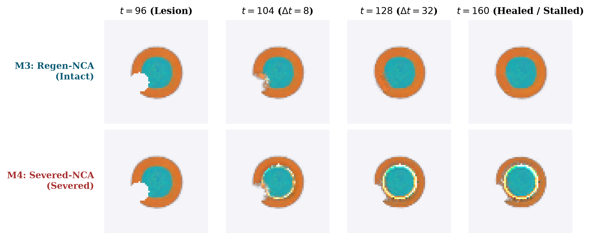

# Beyond Pixel Fidelity: Quantifying Autopoiesis in Perturbed Neural Cellular Automata

[](https://doi.org/10.5281/zenodo.24577198)
[](https://www.python.org/downloads/)
[](https://pytorch.org/)
[](https://opensource.org/licenses/MIT)

Official reproducible research repository for the paper:
> **"Beyond Pixel Fidelity: Information-Theoretic Quantification of Autopoiesis in Perturbed Neural Cellular Automata"**  
> Harsh Diwan · [Read the Preprint PDF](paper/autopoiesis_nca_preprint.pdf)

---

## Visual & Information-Theoretic Results


*Figure 1: RGBA rollouts after an excision lesion $\mathcal{E}_r$ ($r=6$) at $t=96$. Intact **M3: Regen-NCA** regenerates its membrane by $t=160$, whereas severing hidden interface channels (**M4: Severed-NCA**) completely arrests repair despite identical initial pigmentation.*


*Figure 2: (a) Rolling-window interior-to-boundary Transfer Entropy $\text{TE}_{\text{int}\to\text{bnd}}(t)$ showing a transient signaling surge in **M3** during acute wound closure. (b) Steady-state membrane fidelity ($1 - \mathcal{L}_{\text{L2}}^{\text{bnd}}$) under continuous boundary noise $\sigma \in [0.0, 0.20]$.*

---

## Converged 5-Seed Ablation Summary (6,000 Steps)

Evaluated across 5 fixed random seeds (`[42, 101, 202, 303, 404]`, mean $\pm$ std) from `results/ablation_summary.csv`:

| Variant | Training / Test Intervention | Clean $\mathcal{L}_{\text{L2}}$ ($t=96$) | Post-Lesion $\mathcal{L}_{\text{L2}}$ ($t=160$) | $\text{TE}_{\text{int} \to \text{bnd}}$ (nats) | Recovery $\rho_{\text{rec}}$ |
|---|---|---|---|---|---|
| **M1: `Grow-NCA`** | Single-seed rollout only (no pool, no lesions) | $0.001 \pm 0.002$ | $0.031 \pm 0.036$ | $0.024 \pm 0.018$ | $0.486 \pm 0.441$ |
| **M2: `Persist-NCA`** | Sample pool ($N=1024$), zero perturbations | $0.039 \pm 0.051$ | $0.041 \pm 0.050$ | $0.026 \pm 0.023$ | $0.397 \pm 0.381$ |
| **M3: `Regen-NCA`** | Sample pool + random circular excisions ($r \in [4, 8]$) | $0.002 \pm 0.001$ | **$0.002 \pm 0.001$** | $0.012 \pm 0.008$ | **$0.863 \pm 0.075$** |
| **M4: `Severed-NCA`** | Trained `Regen-NCA`, hidden channels zeroed at interface $r \in [9.5, 11]$ | $0.002 \pm 0.001$ | $0.027 \pm 0.009$ | $0.004 \pm 0.004$ | $-1.077 \pm 0.612$ |
| **M5: `Noise-NCA`** | Sample pool + continuous boundary noise ($\sigma = 0.05$) | $0.047 \pm 0.027$ | $0.072 \pm 0.028$ | $0.000 \pm 0.000$ | $0.150 \pm 0.085$ |

- **Causal Proof (`M3` vs. `M4`):** Both share identical weights and clean steady-state loss ($0.002 \pm 0.001$), yet severing hidden interface signaling collapses wound recovery from **+86.3%** to **-107.7%** and cuts Transfer Entropy threefold (`0.012` $\to$ `0.004` nats).
- **Noise Resilience (`M5`):** Retains **`0.99`** steady-state membrane fidelity at $\sigma = 0.10$.

---

## Overview

Growing Neural Cellular Automata (NCAs) demonstrate remarkable self-organizing capabilities, yet standard evaluation benchmarks quantify morphogenesis almost exclusively via Euclidean pixel loss ($\mathcal{L}_{\text{L2}}$). This metric conflates an inert static image with an autopoietic, self-maintaining organism.

This repository operationalizes Maturana & Varela's concept of **autopoiesis** and Friston's **Markov blanket** formalism:
1. **Two-Compartment Organism Geometry:** Partitions an active metabolic core ($\Omega_{\text{int}}$) from a bounding membrane ($\Omega_{\text{bnd}}$) in a 16-channel lattice (4 visible RGBA channels + 12 latent signaling channels).
2. **Transfer Entropy Metric ($\text{TE}_{\text{int} \to \text{bnd}}$):** Quantifies directed causal information flow from interior to membrane via non-parametric Kraskov–Stögbauer–Grassberger (KSG) estimation on SVD-reduced trajectories.
3. **Causal Interface Severing (`M4`):** Proves that membrane regeneration requires interior-to-boundary signaling rather than local edge rules.

---

## Repository Structure

```text
autopoiesis-nca/
├── requirements.txt          # PyTorch, NumPy, SciPy, Matplotlib, Pandas, PyTest
├── Makefile                  # Automated build and test pipeline targets
├── CITATION.cff              # Zenodo / academic citation metadata
├── LICENSE                   # MIT License
├── docs/                     # 300-DPI PNG figures for README display
├── src/
│   ├── __init__.py
│   ├── target.py             # Two-compartment organism mask (Omega_int, Omega_bnd, Omega_env)
│   ├── model.py              # Stochastic 16-channel NCA2D (8,320 trainable parameters)
│   ├── perturbations.py      # Excision lesions E_r and continuous boundary noise G_sigma
│   ├── metrics.py            # Morphological L2, KSG Transfer Entropy, recovery ratio
│   └── train.py              # Experience-replay sample pool trainer for all 4 regimes
├── tests/
│   └── test_sanity.py        # PyTest suite verifying model invariants, KSG TE, causal masking
├── scripts/
│   ├── run_ablations.py      # Evaluates M1..M5 across 5 seeds -> results/ablation_table.tex
│   ├── generate_paper_macros.py
│   └── plot_figures.py       # Generates publication 300-DPI PDF/PNG figures
├── paper/
│   ├── main.tex              # Double-blind manuscript -> main_blind.pdf
│   ├── main_preprint.tex     # Preprint manuscript -> autopoiesis_nca_preprint.pdf
│   └── references.bib        # Complete BibTeX bibliography
└── results/                  # Generated CSV tables, LaTeX tables, and evaluation trajectories
```

---

## Quickstart

```bash
python3 -m venv .venv
source .venv/bin/activate
pip install -r requirements.txt

make test      # Run unit tests
make smoke     # Fast CPU smoke test (< 5 min)
make train-all # Full 5-seed, 6,000-step GPU matrix
make paper     # Regenerate figures and compile manuscript
```

---

## Citation

```bibtex
@article{diwan2026autopoiesis,
  title={Beyond Pixel Fidelity: Information-Theoretic Quantification of Autopoiesis in Perturbed Neural Cellular Automata},
  author={Diwan, Harsh},
  year={2026},
  doi={10.5281/zenodo.24577198},
  url={https://github.com/realharshdiwan/autopoiesis-nca}
}
```
