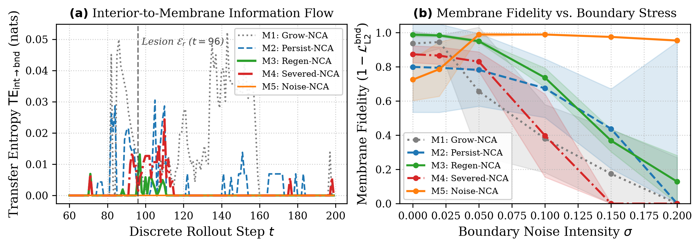

<div align="center">

# Beyond Pixel Fidelity
### Information-Theoretic Quantification of Autopoiesis in Perturbed Neural Cellular Automata

[](https://doi.org/10.5281/zenodo.24577198)
[](paper/autopoiesis_nca_preprint.pdf)
[](https://www.python.org/downloads/)
[](https://pytorch.org/)
[](LICENSE)

**Harsh Diwan** · Dayananda Sagar University, Bengaluru, India  
[`harsh-diwan@proton.me`](mailto:harsh-diwan@proton.me) · [Read the 4-Page Preprint (PDF)](paper/autopoiesis_nca_preprint.pdf)

</div>

---

> **Core Hypothesis:** Static pixel loss (<i>L</i><sub>2</sub>) cannot distinguish an inert frozen pattern from a living, self-maintaining system. By partitioning a 16-channel Neural Cellular Automaton into an interior core (Ω<sub>int</sub>) and bounding membrane (Ω<sub>bnd</sub>), we show that wound regeneration is causally driven by directed interior-to-boundary Transfer Entropy (TE<sub>int→bnd</sub>).

---

## Visual & Causal Evidence

<p align="center">
  
  <br/>
  <sub><b>Figure 1: Visual and Causal Dynamics of Membrane Regeneration.</b> RGBA rollouts after an excision lesion (<i>r</i> = 6) at <i>t</i> = 96. Intact <b>M3: Regen-NCA</b> (top) reconstructs its membrane by <i>t</i> = 160, whereas severing hidden interface channels in <b>M4: Severed-NCA</b> (bottom) completely arrests repair despite identical initial pigmentation.</sub>
</p>

<p align="center">
  
  <br/>
  <sub><b>Figure 2: Information-Theoretic Signature of Autopoiesis.</b> <b>(a)</b> Rolling-window Transfer Entropy TE<sub>int→bnd</sub>(<i>t</i>) showing a localized signaling surge in <b>M3</b> during acute wound closure (<i>t</i> ∈ [96, 115]), whereas unregularized <b>M1</b> exhibits late post-horizon drift. <b>(b)</b> Steady-state membrane fidelity (1 − L2<sub>bnd</sub>) under continuous boundary noise <i>σ</i> ∈ [0.0, 0.20].</sub>
</p>

---

## Converged 5-Seed Ablation Results (`6,000` Steps)

Evaluated across **5 fixed seeds** (`[42, 101, 202, 303, 404]`, mean ± std) from [`results/ablation_summary.csv`](results/ablation_summary.csv):

| Variant | Training / Test Intervention | Clean <i>L</i><sub>2</sub> (<i>t</i>=96) | Post-Lesion <i>L</i><sub>2</sub> (<i>t</i>=160) | TE<sub>int→bnd</sub> (nats) | Recovery <i>ρ</i><sub>rec</sub> |
| :--- | :--- | :---: | :---: | :---: | :---: |
| **M1: `Grow-NCA`** | Single-seed rollout only (no pool, no lesions) | `0.001 ± 0.002` | `0.031 ± 0.036` | `0.024 ± 0.018` | `0.486 ± 0.441` |
| **M2: `Persist-NCA`** | Sample pool (<i>N</i> = 1024), zero perturbations | `0.039 ± 0.051` | `0.041 ± 0.050` | `0.026 ± 0.023` | `0.397 ± 0.381` |
| **M3: `Regen-NCA`** | Sample pool + random excisions (<i>r</i> ∈ [4, 8]) | `0.002 ± 0.001` | **`0.002 ± 0.001`** | `0.012 ± 0.008` | **`0.863 ± 0.075`** |
| **M4: `Severed-NCA`** | Trained `Regen-NCA`, hidden interface zeroed (<i>r</i> ∈ [9.5, 11]) | `0.002 ± 0.001` | `0.027 ± 0.009` | `0.004 ± 0.004` | `-1.077 ± 0.612` |
| **M5: `Noise-NCA`** | Sample pool + boundary noise (<i>σ</i> = 0.05) | `0.047 ± 0.027` | `0.072 ± 0.028` | `0.000 ± 0.000` | `0.150 ± 0.085` |

- **Causal Proof (`M3` vs. `M4`):** Identical weights and clean morphology (`0.002 ± 0.001`), yet severing hidden interface signaling collapses recovery from **`+86.3%`** to **`-107.7%`** and cuts Transfer Entropy threefold (`0.012` → `0.004` nats).
- **Noise Resilience (`M5`):** Retains **`0.99`** steady-state membrane fidelity at <i>σ</i> = 0.10.

---

## Method & Architecture

- **Compact 16-Channel NCA (`8,320` params):** Fixed depthwise Sobel + Identity perception (`48` channels) → `1×1 Conv` (`128`, ReLU) → zero-initialized `1×1 Conv` (`16`), gated by asynchronous stochastic firing (`p = 0.5`) and neighborhood viability (`α > 0.1`).
- **Two-Compartment Markov Blanket:** Teal interior core (Ω<sub>int</sub>, <i>r</i> ≤ 10), orange bounding membrane (Ω<sub>bnd</sub>, 10 < <i>r</i> ≤ 16), and 1-pixel interface (Ω<sub>interface</sub>, 9.5 ≤ <i>r</i> ≤ 11).
- **KSG Transfer Entropy:** Spatial mean hidden trajectories projected via SVD (<i>d</i> = 2) and evaluated using non-parametric Kraskov–Stögbauer–Grassberger estimation (<i>k</i> = 4, Chebyshev <i>L</i><sub>∞</sub>).

---

## Quickstart & Reproducibility

```bash
git clone https://github.com/realharshdiwan/autopoiesis-nca.git
cd autopoiesis-nca
python3 -m venv .venv && source .venv/bin/activate
pip install -r requirements.txt

make test       # Run unit & invariant tests (5/5)
make smoke      # Fast end-to-end CPU smoke test (< 5 min)
make train-all  # Full 5-seed, 6,000-step GPU matrix
make paper      # Regenerate figures and compile PDF
```

<details>
<summary><b>Repository Structure</b></summary>

```text
autopoiesis-nca/
├── CITATION.cff              # Zenodo / academic citation metadata
├── LICENSE                   # MIT License
├── Makefile                  # Automated build, test, and paper targets
├── requirements.txt          # PyTorch, NumPy, SciPy, Matplotlib, Pandas, PyTest
├── docs/                     # 300-DPI PNG figures for GitHub README
├── src/
│   ├── target.py             # Two-compartment Markov blanket masks
│   ├── model.py              # Stochastic 16-channel NCA2D (8,320 params)
│   ├── perturbations.py      # Excision lesions E_r and boundary noise G_sigma
│   ├── metrics.py            # Morphological L2, KSG Transfer Entropy, recovery ratio
│   └── train.py              # Deterministic sample-pool trainer
├── tests/
│   └── test_sanity.py        # Unit tests for invariants, KSG TE, causal masking
├── scripts/
│   ├── run_ablations.py      # 5-seed evaluation -> results/ablation_table.tex
│   ├── generate_paper_macros.py
│   └── plot_figures.py       # 300-DPI PDF/PNG figure generation
├── paper/
│   ├── main.tex              # Anonymized double-blind manuscript -> main_blind.pdf
│   ├── main_preprint.tex     # Preprint manuscript -> autopoiesis_nca_preprint.pdf
│   └── references.bib        # Verified BibTeX bibliography
└── results/                  # 5-seed CSVs, NPZ trajectories, and LaTeX macros/tables
```

</details>

---

## Citation

```bibtex
@article{diwan2026autopoiesis,
  title={Beyond Pixel Fidelity: Information-Theoretic Quantification of Autopoiesis in Perturbed Neural Cellular Automata},
  author={Diwan, Harsh},
  year={2026},
  doi={10.5281/zenodo.24577198},
  url={https://github.com/realharshdiwan/autopoiesis-nca}
}
```
